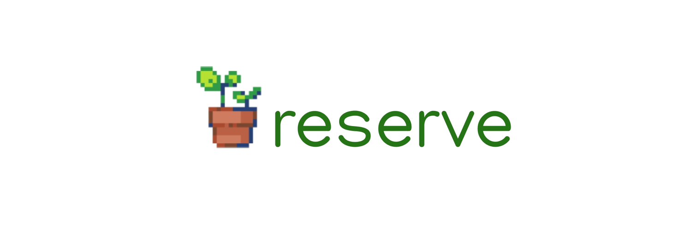

[](https://shields.io/)
[](https://pypi.python.org/pypi/ansicolortags/)
[](https://GitHub.com/mericxy/ReservaUFAM/commit/)
[](https://GitHub.com/mericxy/ReservaUFAM/commit/)
[](https://GitHub.com/mericxy/ReservaUFAM/watchers/)

<h1 align="center">
    
</h1>

<h4 align="center"> 
	✅ ReservaUFAM � Sistema completo de gestão de reservas da UFAM
</h4>

<p align="center">
  <a href="#-sobre-o-projeto">Sobre</a> •
  <a href="#-funcionalidades-principais">Funcionalidades</a> •
  <a href="#️-arquitetura-e-tecnologias">Tecnologias</a> •
  <a href="#-guia-de-instalação-e-execução">Instalação</a> •
  <a href="#-documentação-adicional">Documentação</a> •
  <a href="#-licença-e-direitos-autorais">Licença</a>
</p>

## 💻 Sobre o projeto
O **ReservaUFAM** é um sistema web completo desenvolvido para modernizar e centralizar o processo de agendamento de recursos institucionais da Universidade Federal do Amazonas (UFAM). A plataforma substitui os métodos manuais tradicionais por uma solução digital integrada, oferecendo maior eficiência, transparência e controle na gestão de salas, auditórios e veículos.

Projeto desenvolvido para as disciplinas de **Engenharia de Aplicações Web** e **Manutenção e Integração de Software** do curso de Engenharia de Software da UFAM.

## ✨ Funcionalidades Principais

### 🔐 Sistema de Autenticação e Autorização
- **Cadastro exclusivo** para professores e técnicos da UFAM
- **Autenticação JWT** com login via CPF ou SIAPE
- **Perfis de usuário diferenciados**: Administrador, Professor, Técnico
- **Sistema de aprovação** de cadastros pelos administradores
- **Recuperação de senha** via e-mail integrado
- **Conformidade LGPD** com consentimento e políticas de privacidade

### 📅 Gerenciamento Completo de Reservas
- **Reserva de múltiplos recursos**: Auditórios, Salas de Reunião e Veículos
- **Agenda inteligente** com validação de conflitos de horário
- **Sistema de prioridades** (primeira solicitação tem preferência)
- **Workflow de aprovação** com notificações automáticas
- **Histórico completo** de reservas por usuário
- **Cancelamento de reservas** com justificativa

### 🎛️ Painel Administrativo Avançado
- **Dashboard centralizado** para gestão de todos os recursos
- **Aprovação/rejeição** de cadastros e reservas
- **Gerenciamento de recursos** (criação, edição, exclusão)
- **Relatórios e estatísticas** de uso dos recursos
- **Controle de usuários** com diferentes níveis de acesso
- **Auditoria de ações** do sistema

### 📧 Notificações e Comunicação
- **Integração SendGrid** para envio automático de e-mails
- **Confirmações de reserva** em tempo real
- **Notificações de status** (aprovação, cancelamento, rejeição)
- **Lembretes automáticos** de reservas próximas
- **E-mails de verificação** para novos cadastros

### 🔒 Segurança e Conformidade
- **Criptografia de senhas** com hash seguro
- **Proteção CSRF** e validações de entrada
- **Conformidade LGPD** completa com:
  - Consentimento explícito para tratamento de dados
  - Política de privacidade transparente
  - Direito ao esquecimento (exclusão/anonimização de dados)
  - Registro de consentimento com IP e timestamp
- **Auditoria de acessos** e ações críticas

### 📱 Interface e Experiência do Usuário
- **Design responsivo** otimizado para desktop e mobile
- **Interface moderna** com TailwindCSS 4.1
- **Componentes reutilizáveis** e acessíveis
- **Navegação intuitiva** com feedback visual
- **Indicadores de carregamento** e tratamento de erros
- **Tempo de resposta inferior a 3 segundos** 

## 🛠️ Arquitetura e Tecnologias

### Stack Tecnológico Completo


### Backend (API RESTful)
- **Framework**: Django 5.1.6 + Django REST Framework 3.15.2
- **Autenticação**: JWT (Simple JWT 5.5.0)
- **Banco de Dados**: PostgreSQL 12+ com psycopg2
- **E-mail**: SendGrid API v5 integrada
- **Testes**: pytest + pytest-django
- **Segurança**: CORS configurado, validações LGPD

### Frontend (SPA - Single Page Application)  
- **Framework**: React 18.3.1 + React Router DOM 7.2.0
- **Build Tool**: Vite 5.4.1 (HMR rápido)
- **Estilização**: TailwindCSS 4.1.13 + PostCSS 8
- **HTTP Client**: Axios 1.8.1
- **Componentes**: Lucide React (ícones), React DatePicker
- **Validação**: ESLint 9 com regras React

### Infraestrutura e DevOps
- **Containerização**: Docker + Docker Compose
- **Banco de Dados**: PostgreSQL em container
- **Variáveis de Ambiente**: python-dotenv para configurações
- **Hot Reload**: Desenvolvimento com volumes mapeados 

## 🚀 Guia de Instalação e Execução

### 📌 Pré-requisitos Essenciais
Certifique-se de ter as seguintes ferramentas instaladas:

**🐳 Containerização (Recomendado)**
- [Docker](https://www.docker.com/) (20+)
- [Docker Compose](https://docs.docker.com/compose/) (2.0+)
- [Git](https://git-scm.com/)

**🛠️ Desenvolvimento Local (Opcional)**
- [Python](https://www.python.org/) (3.11+)
- [Node.js](https://nodejs.org/) (18+ LTS)
- [PostgreSQL](https://www.postgresql.org/) (12+)
- [npm](https://www.npmjs.com/) ou [yarn](https://yarnpkg.com/)

### 🔧 Instalação com Docker (Método Recomendado)

1. **Clone o repositório:**
   ```bash
   git clone https://github.com/mericxy/ReservaUFAM.git
   cd ReservaUFAM/src
   ```

2. **Configure as variáveis de ambiente:**
   ```bash
   # Copie o arquivo de exemplo (se disponível)
   cp .env.example .env
   
   # Edite o arquivo .env com suas configurações
   nano .env
   ```

3. **Inicie o ambiente completo:**
   ```bash
   # Construa e inicie todos os containers
   docker-compose up --build -d
   
   # Acompanhe os logs em tempo real (opcional)
   docker-compose logs -f
   ```

4. **Execute as migrações do banco de dados:**
   ```bash
   # Entre no container do backend
   docker exec -it reservaufam_backend bash
   
   # Execute as migrações
   python manage.py migrate
   
   # Crie um superusuário (opcional)
   python manage.py createsuperuser
   
   # Saia do container
   exit
   ```

5. **Acesse a aplicação:**
   - **Frontend React**: [http://localhost:5173](http://localhost:5173)
   - **Backend Django API**: [http://localhost:8000](http://localhost:8000)
   - **Admin Django**: [http://localhost:8000/admin](http://localhost:8000/admin)

### 🛠️ Comandos Úteis do Docker

```bash
# Parar o ambiente
docker-compose down

# Parar e remover volumes (limpa banco de dados)
docker-compose down -v

# Reconstruir apenas um serviço
docker-compose up --build backend

# Visualizar logs de um serviço específico
docker-compose logs -f frontend

# Entrar no container do frontend
docker exec -it reservaufam_frontend bash

# Instalar nova dependência no backend
docker exec -it reservaufam_backend pip install <package>

# Executar testes no backend
docker exec -it reservaufam_backend python manage.py test
```

### 💻 Instalação Local (Desenvolvimento)

<details>
<summary>Clique para ver instruções de instalação local</summary>

#### Backend (Django)
```bash
cd backend

# Crie um ambiente virtual
python -m venv venv
source venv/bin/activate  # Linux/macOS
# ou
venv\Scripts\activate     # Windows

# Instale as dependências
pip install -r requirements.txt

# Configure o banco de dados PostgreSQL
# Edite src/setup/settings.py com suas credenciais

# Execute as migrações
python manage.py migrate

# Crie um superusuário
python manage.py createsuperuser

# Inicie o servidor
python manage.py runserver
```

#### Frontend (React)
```bash
cd frontend

# Instale as dependências
npm install

# Inicie o servidor de desenvolvimento
npm run dev

# Ou construa para produção
npm run build
```

</details>

### 🔍 Verificação da Instalação

Após a instalação, verifique se tudo está funcionando:

1. ✅ **Frontend carregando**: Acesse [http://localhost:5173](http://localhost:5173)
2. ✅ **API respondendo**: Acesse [http://localhost:8000/api/](http://localhost:8000/api/)
3. ✅ **Banco conectado**: Verifique logs do Docker
4. ✅ **Admin disponível**: Acesse [http://localhost:8000/admin](http://localhost:8000/admin)

### 🚨 Solução de Problemas Comuns

<details>
<summary>Erro de conexão com banco de dados</summary>

```bash
# Verifique se o container do PostgreSQL está rodando
docker-compose ps

# Reinicie apenas o banco de dados
docker-compose restart db

# Verifique os logs do banco
docker-compose logs db
```
</details>

<details>
<summary>Erro de permissões no Docker</summary>

```bash
# Linux: Adicione seu usuário ao grupo docker
sudo usermod -aG docker $USER

# Faça logout e login novamente, ou execute:
newgrp docker
```
</details>

<details>
<summary>Frontend não carrega após mudanças</summary>

```bash
# Limpe o cache do Vite
docker exec -it reservaufam_frontend npm run build

# Ou reinicie o container
docker-compose restart frontend
```
</details>

## 📋 Requisitos Funcionais Detalhados

### 🔑 Autenticação e Gestão de Usuários
- **Cadastro**: Exclusivo para professores e técnicos da UFAM
- **Dados obrigatórios**: SIAPE (7 dígitos), CPF (11 dígitos), nome, e-mail, telefone, senha
- **Validações**: SIAPE e CPF únicos, formato de e-mail válido
- **Status de usuário**: Pendente → Aprovado/Reprovado/Bloqueado
- **Aprovação automática**: Professores pré-cadastrados na base UFAM
- **Perfis de acesso**: Administrador, Professor, Técnico com permissões diferenciadas

### 📅 Sistema de Reservas Inteligente
- **Recursos disponíveis**: Auditórios, Salas de Reunião, Veículos
- **Dados da reserva**: Período (data/hora início/fim), recurso, descrição, justificativa
- **Regras de conflito**: Sistema previne agendamentos simultâneos
- **Priorização**: Primeira solicitação válida tem preferência
- **Aprovação obrigatória**: Todas as reservas passam por moderação administrativa
- **Estados**: Pendente → Confirmado/Cancelado

### 🎛️ Painel Administrativo Completo
- **Gestão de usuários**: Aprovar/reprovar cadastros, gerenciar perfis
- **Gestão de recursos**: CRUD completo de auditórios, salas e veículos
- **Gestão de reservas**: Aprovar/rejeitar/cancelar reservas
- **Relatórios**: Estatísticas de uso, histórico de reservas
- **Configurações**: Parâmetros do sistema, políticas de uso

### 📧 Sistema de Notificações
- **E-mails automáticos**: Confirmação de cadastro, status de reservas
- **Integração SendGrid**: API confiável para entrega de e-mails
- **Templates personalizados**: E-mails com identidade visual da UFAM
- **Logs de envio**: Rastreamento de entregas e falhas

## ⚙️ Requisitos Não Funcionais

### 🚀 Performance e Escalabilidade
- **Tempo de resposta**: < 3 segundos para todas as operações
- **Concurrent users**: Suporte a múltiplos usuários simultâneos
- **Database optimization**: Índices otimizados, queries eficientes
- **Caching strategy**: Cache de consultas frequentes

### 🔒 Segurança e Conformidade
- **Autenticação**: JWT com refresh tokens
- **Autorização**: Role-based access control (RBAC)
- **Criptografia**: Bcrypt para senhas, HTTPS obrigatório
- **LGPD compliance**: Consentimento, políticas de privacidade, direito ao esquecimento
- **Auditoria**: Logs de ações críticas e acessos

### 📱 Usabilidade e Acessibilidade
- **Design responsivo**: Mobile-first, breakpoints otimizados
- **Acessibilidade**: WCAG 2.1 AA, navegação por teclado
- **UX intuitiva**: Fluxos simplificados, feedback visual claro
- **Cross-browser**: Compatibilidade com navegadores modernos

### 🔧 Manutenibilidade e DevOps
- **Containerização**: Docker para desenvolvimento e produção
- **Code quality**: ESLint, Prettier, testes automatizados
- **Documentation**: Código autodocumentado, README detalhado
- **Version control**: Git com conventional commits  

## 🎯 Casos de Uso Principais

### � Para Professores e Técnicos
1. **Cadastro no Sistema**
   - Registrar-se com SIAPE, CPF e dados pessoais
   - Aceitar políticas de privacidade (LGPD)
   - Aguardar aprovação administrativa

2. **Realizar Reservas**
   - Navegar pelo calendário de recursos disponíveis
   - Selecionar auditório, sala ou veículo
   - Definir período, horário e justificativa
   - Acompanhar status da solicitação

3. **Gerenciar Perfil**
   - Atualizar dados pessoais
   - Visualizar histórico de reservas
   - Cancelar reservas quando necessário

### 👨‍💼 Para Administradores
1. **Gestão de Usuários**
   - Aprovar/reprovar novos cadastros
   - Gerenciar perfis e permissões
   - Bloquear usuários quando necessário

2. **Gestão de Recursos**
   - Cadastrar novos auditórios, salas e veículos
   - Editar capacidades e localizações
   - Remover recursos indisponíveis

3. **Moderação de Reservas**
   - Revisar solicitações pendentes
   - Aprovar/rejeitar com justificativas
   - Resolver conflitos de agendamento

## 🏛️ Público-Alvo

- **👨‍🏫 Professores da UFAM**: Reserva de espaços para aulas, palestras, defesas
- **🔧 Técnicos Administrativos**: Agendamento de recursos para eventos institucionais
- **👨‍💼 Gestores**: Controle centralizado de recursos institucionais
- **📊 Coordenadores**: Planejamento de atividades acadêmicas

## 📚 Documentação Adicional

### 📁 Estrutura de Documentação
```
📂 docs/
├── 📄 funcionalidades.md          # Detalhes técnicos das funcionalidades
├── 📄 manual-dev.md               # Manual do desenvolvedor
├── 📄 fluxo-do-sistema.md         # Diagramas e fluxos do sistema
├── 📄 LGPD_IMPLEMENTATION.md      # Implementação de conformidade LGPD
├── 📄 Politica-Interna-Protecao-Dados.md
├── 📄 Procedimento-Gestao-Consentimento.md
└── 🖼️  img/                       # Capturas de tela e diagramas
```

### 🔗 Links Importantes
- **Manual do Desenvolvedor**: [docs/manual-dev.md](./docs/manual-dev.md)
- **Funcionalidades Detalhadas**: [docs/funcionalidades.md](./docs/funcionalidades.md)
- **Conformidade LGPD**: [docs/LGPD_IMPLEMENTATION.md](./docs/LGPD_IMPLEMENTATION.md)
- **Relatório do Projeto**: [RELATORIO.md](../RELATORIO.md)

## 🔄 Fluxos do Sistema

### 🔐 Fluxo de Autenticação
```
Cadastro → Verificação E-mail → Aprovação Admin → Login → Acesso Sistema
```

### 📅 Fluxo de Reserva
```
Login → Seleção Recurso → Escolha Data/Hora → Justificativa → 
Envio Solicitação → Análise Admin → Notificação → Confirmação/Rejeição
```

### 🎛️ Fluxo Administrativo
```
Login Admin → Dashboard → Gestão (Usuários/Recursos/Reservas) → 
Aprovação/Rejeição → Notificação Automática → Relatórios
```

## 🤝 Contribuição

### 💻 Para Desenvolvedores

1. **Fork o projeto**
2. **Crie uma branch para sua feature**
   ```bash
   git checkout -b feature/nova-funcionalidade
   ```
3. **Implemente suas mudanças**
4. **Execute os testes**
   ```bash
   docker exec -it reservaufam_backend python manage.py test
   npm test  # No frontend
   ```
5. **Commit suas mudanças**
   ```bash
   git commit -m 'feat: adiciona nova funcionalidade'
   ```
6. **Push para a branch**
   ```bash
   git push origin feature/nova-funcionalidade
   ```
7. **Abra um Pull Request**

### 📋 Padrões de Código
- **Backend**: Seguir PEP 8 (Python), usar Black para formatação
- **Frontend**: Seguir ESLint rules, usar Prettier
- **Commits**: Conventional Commits (feat, fix, docs, style, refactor, test, chore)
- **Documentação**: Sempre documentar novas funcionalidades

## 📞 Suporte e Contato

### 🏫 Equipe do Projeto
- **Universidade**: Universidade Federal do Amazonas (UFAM)
- **Curso**: Engenharia de Software
- **Disciplinas**: Engenharia de Aplicações Web | Manutenção e Integração de Software

### 🐛 Reportar Bugs
- Abra uma [issue no GitHub](https://github.com/mericxy/ReservaUFAM/issues)
- Forneça logs, capturas de tela e passos para reproduzir
- Use templates de issue quando disponíveis

### 💡 Sugestões de Melhorias
- Abra uma [issue com label "enhancement"](https://github.com/mericxy/ReservaUFAM/issues)
- Descreva claramente o problema atual e a solução proposta
- Considere implementar e abrir um Pull Request

## 📜 Licença e Direitos Autorais

### 📄 Licença MIT
Este projeto é de código aberto e distribuído sob a [Licença MIT](./LICENSE).

```
MIT License

Copyright (c) 2024 Universidade Federal do Amazonas - UFAM
Engenharia de Software - ReservaUFAM

Permission is hereby granted, free of charge, to any person obtaining a copy
of this software and associated documentation files (the "Software"), to deal
in the Software without restriction, including without limitation the rights
to use, copy, modify, merge, publish, distribute, sublicense, and/or sell
copies of the Software, and to permit persons to whom the Software is
furnished to do so, subject to the following conditions:

The above copyright notice and this permission notice shall be included in all
copies or substantial portions of the Software.

THE SOFTWARE IS PROVIDED "AS IS", WITHOUT WARRANTY OF ANY KIND, EXPRESS OR
IMPLIED, INCLUDING BUT NOT LIMITED TO THE WARRANTIES OF MERCHANTABILITY,
FITNESS FOR A PARTICULAR PURPOSE AND NONINFRINGEMENT. IN NO EVENT SHALL THE
AUTHORS OR COPYRIGHT HOLDERS BE LIABLE FOR ANY CLAIM, DAMAGES OR OTHER
LIABILITY, WHETHER IN AN ACTION OF CONTRACT, TORT OR OTHERWISE, ARISING FROM,
OUT OF OR IN CONNECTION WITH THE SOFTWARE OR THE USE OR OTHER DEALINGS IN THE
SOFTWARE.
```

### ⚖️ Termos de Uso
- ✅ **Uso comercial permitido**
- ✅ **Modificação permitida** 
- ✅ **Distribuição permitida**
- ✅ **Uso privado permitido**
- ❗ **Sem garantias** - Software fornecido "como está"
- ❗ **Responsabilidade limitada** - Autores não são responsáveis por danos

---

<div align="center">
  
### 🎓 Projeto Acadêmico - UFAM 2024/2025
  
**Desenvolvido com ❤️ para a comunidade acadêmica da UFAM**

[](https://github.com/mericxy/ReservaUFAM)
[](#-licença-e-direitos-autorais)
[](https://ufam.edu.br/)

**Se este projeto foi útil para você, considere dar uma ⭐ no repositório!**

</div>
